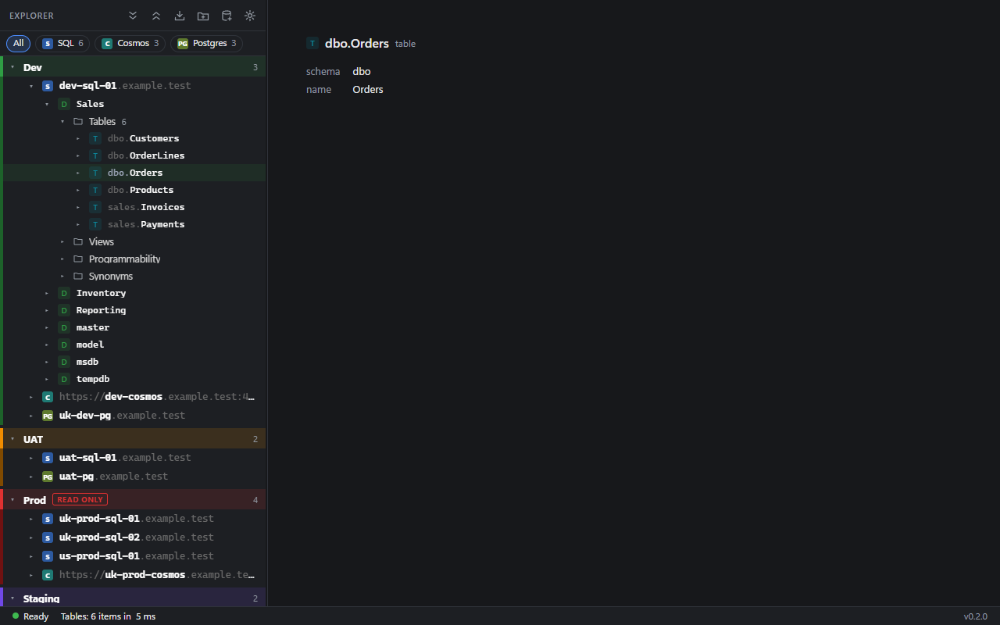
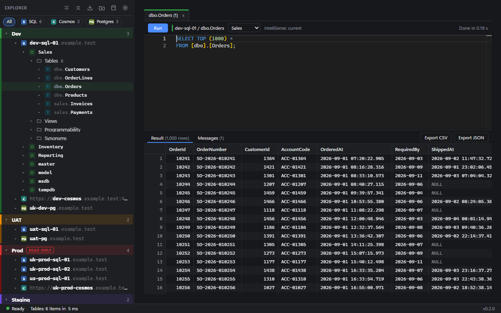
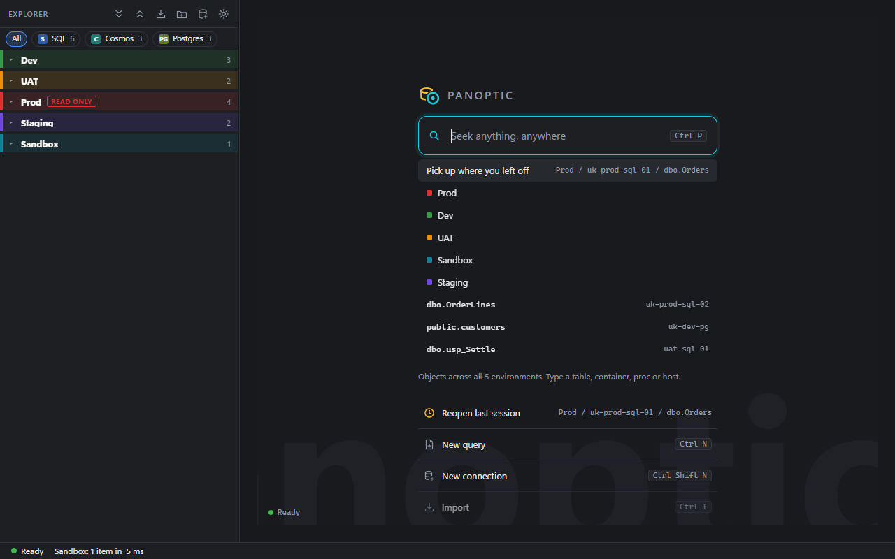

# Panoptic

[](https://github.com/afrugalpenguin/panoptic/actions/workflows/ci.yml)
[](https://github.com/afrugalpenguin/panoptic/releases/latest)
[](https://github.com/afrugalpenguin/panoptic/releases)

[](LICENSE)

A fast desktop database client for SQL Server, Azure SQL, Azure Synapse, Cosmos DB and
PostgreSQL. One explorer holds every environment at once (dev, UAT, prod, client sandboxes) and
every engine side by side in the same tree, with a query editor and results grid hanging off
whatever you select.

It is built for the everyday work of browsing, querying and checking data across many
environments, and for doing that faster than any one engine's own tool. Engine-specific admin
surfaces (SQL Agent, security, backup and restore) are out of scope; the vendor tools stay the
place for those.



*The explorer: every environment and engine in one tree (sample data).*

## What it does today

- **Explorer.** One tree with every environment, and SQL Server, Azure SQL, Synapse, Cosmos DB and
  PostgreSQL connections side by side. Filter by engine, expand or collapse every environment at
  once, and reorder environments from their right-click menu. Environments are optional: drag a
  connection onto one to group it, or leave it ungrouped.
- **Start page.** Seek finds environments, connections and recent objects from one box (Ctrl+P),
  and Reopen last session picks up where you left off.
- **Query editor.** T-SQL, Cosmos SQL and PostgreSQL, with results streamed into a grid, several
  result sets, messages, an elapsed timer and cancel. Export to CSV or JSON, and Select top 1000
  on any table, view or container.
- **New query before connecting.** Ctrl+N opens a Query N tab you can type into straight away,
  then pick a connection for it.
- **IntelliSense.** Completion and hover for tables, views, columns, procedures and functions, and
  for Cosmos the property paths in each container. Unknown names are underlined before you run.
- **Errors at the right spot.** A failed query marks the bad name in the editor and suggests the
  closest name the database has, with a quick fix.
- **Coming from SQL Server to Postgres.** The PostgreSQL editor flags T-SQL habits such as `TOP`,
  `[brackets]`, `GETDATE()` and `ISNULL` before you run, with a quick fix to the Postgres form.
- **Drag and copy names.** Drag a table, view, column, database or container into the editor to
  insert its name, or use Copy name to put it on the clipboard, quoted the way the engine needs.
- **Cancellable explorer loads.** A slow expand can be stopped with Cancel in the status bar, and
  collapsing a node that is still loading stops it too.
- **Explorer errors inline.** A node that fails to load says why in one line in the tree, in
  plain English for common failures, with the full details in a Problems tab.
- **Read-only environments.** Queries against an environment marked read-only are rolled back, and
  a `COMMIT` in the script stops the run and flags it as committed. On PostgreSQL the server
  refuses every write.
- **Sign-in.** Microsoft Entra (Windows sign-in or device code), SQL login, Windows
  authentication, Cosmos account keys and Postgres username and password. Secrets are stored
  encrypted on your machine.
- **Import.** Saved connections from SSMS, Azure Data Studio and VS Code.
- **Updates.** Panoptic updates itself from GitHub Releases, and a What's new tab shows what
  changed. No telemetry; the update check is the only outbound call.



*Select top 1000 on a table, with results and messages (sample data).*



*The start page with nothing typed: Seek, recent objects and quick actions (sample data).*

What comes next is in [docs/plan.md](docs/plan.md) and the
[open issues](https://github.com/afrugalpenguin/panoptic/issues). Decisions are in
[docs/adr/](docs/adr/), each connector is described in [docs/connectors/](docs/connectors/),
measurements are in [docs/benchmarks.md](docs/benchmarks.md), and the design rounds behind the
UI, with every option that was drawn, are in [docs/mockups/](docs/mockups/).

Windows only until v1. The stack (Tauri and .NET) can reach Mac and Linux later, but Windows is
the only tested target.

## Install

Download `Panoptic_<version>_x64-setup.exe` from the
[latest release](https://github.com/afrugalpenguin/panoptic/releases/latest) and run it. It
installs per-user into `%LOCALAPPDATA%\Panoptic` with no elevation and updates itself. To run
without installing, unzip `Panoptic_<version>_x64-portable.zip` anywhere and run `panoptic.exe`.

Builds are not code-signed yet. SmartScreen may warn on first install, and Microsoft Defender may
quarantine `panoptic.exe` as `Trojan:Win32/Bearfoos.A!ml`, a false positive on an unsigned file.
Until builds are signed, allow that detection in Defender's Protection history and reinstall; do
not exclude the whole install folder. Details, and how updates are checked, are in
[docs/install.md](docs/install.md).

## Develop

Needs Rust (MSVC), Node 24 with pnpm, and the .NET 10 SDK.

```powershell
pnpm install
pnpm dev     # framework-dependent sidecar, Vite dev server
pnpm dev:seeded  # the same, on a separate store with Prod, UAT and Test (20 connections)
pnpm test    # vitest + sidecar xunit
pnpm build   # self-contained sidecar + release build + installer
```

`pnpm dev:seeded` keeps its profile in `%APPDATA%\Panoptic\dev-seeded` and never touches your
real store; `scripts\dev-seeded.ps1 -Reset` seeds it again. Test's first three connections are the
local Docker databases from `scripts\dev-db.ps1`; the rest are synthetic and fail to expand.

Locally, `pnpm build` writes the installer to `apps/desktop/src-tauri/target/release/bundle/nsis/`
and then fails at signing the update, because the updater's private key is only in GitHub Secrets.
The installer it wrote is complete.

How releases, versions and change fragments work is in [docs/release.md](docs/release.md).

The UI is Svelte 5 in a Tauri 2 shell. Data access runs in a .NET 10 sidecar over JSON-RPC on
stdio, because Microsoft.Data.SqlClient and the Cosmos .NET SDK are the mature drivers with
Entra support. Why the sidecar is a self-contained JIT build rather than Native AOT is in
[ADR 0001](docs/adr/0001-stack.md).

## License

[MIT](LICENSE)
