# Mockups

The design rounds behind Panoptic's UI, in the order they happened. Each round
started with a question, got two or three directions drawn up, and ended with a
decision. The chosen one is marked, and the reasons for the choice are written
down so they don't get re-litigated later.

Every mockup is a standalone HTML file with a PNG beside it, rendered at 2x. The
HTML files open in any browser. All server names, databases and objects are
made up (a fictional "Fabrikam" estate); nothing here is a real environment.

The specs these rounds fed into: [explorer-ux.md](../explorer-ux.md),
[landing.md](../landing.md), [changelog-and-whats-new.md](../changelog-and-whats-new.md).

## 1. Explorer: making hostnames readable (29 Oct 2026)

The first version of the tree showed every connection by its full hostname.
When all of them share a long common prefix and suffix, the part that matters
(`dev`, `uat`, `uk`) is lost in the middle of a 40-character string, and the
environment headers didn't stand out enough to help.

| Current | A: Display names | B: Dimmed prefix (chosen) | C: Pipeline bands |
| :--: | :--: | :--: | :--: |
| 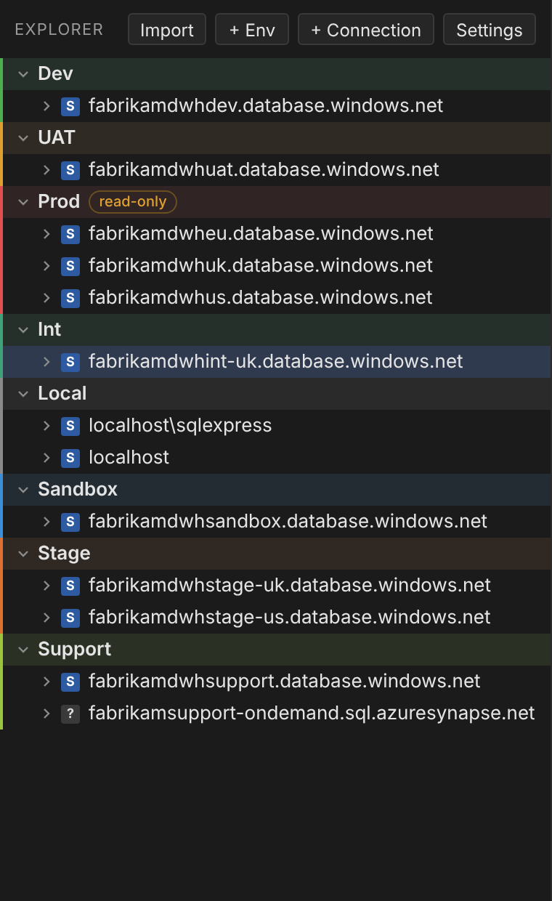 | 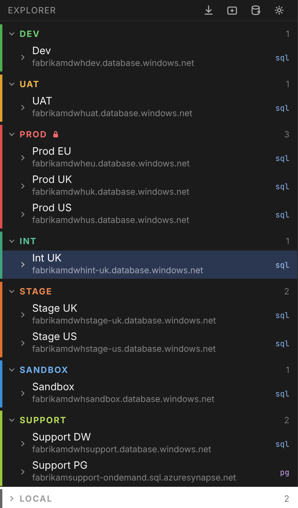 | 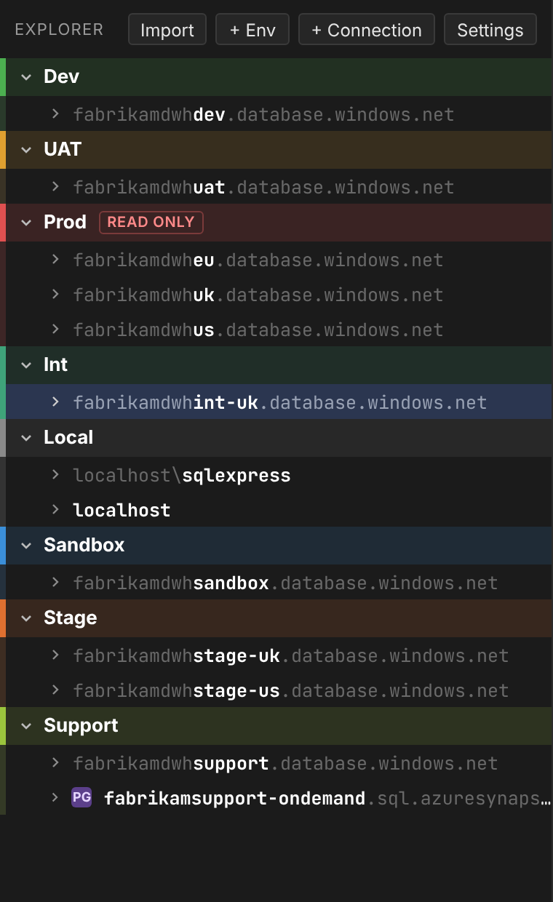 | 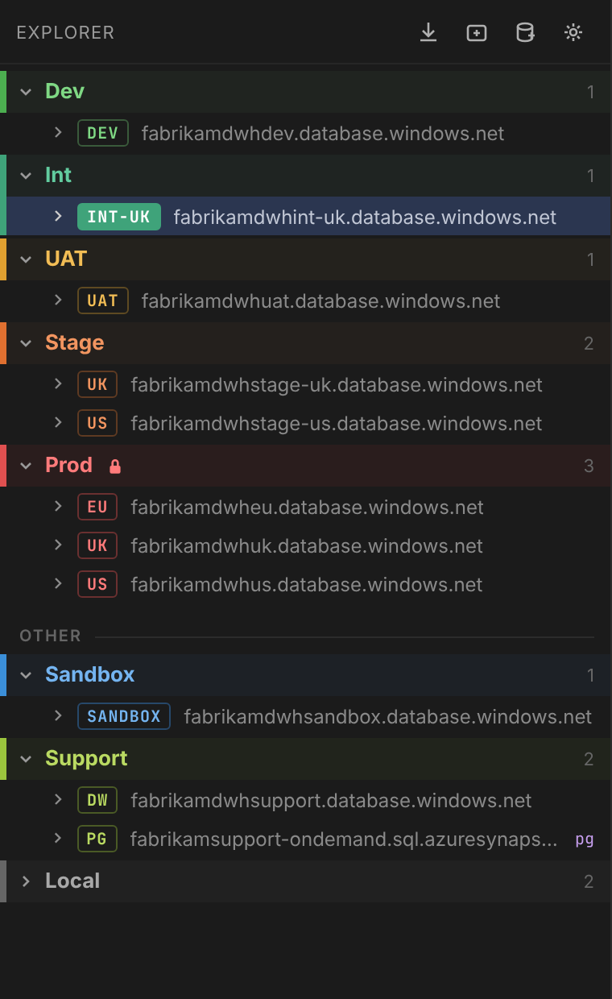 |

- **A: Display names.** Each connection gets a friendly alias ("Prod UK") with the
  hostname underneath in small grey text. Readable, but it means maintaining a
  second name for every connection, and the alias can drift from the truth.
- **B: Dimmed prefix.** Keep the real hostname, work out the common prefix and
  suffix across the siblings, and dim those parts so only the distinguishing
  piece is bright. Environment headers get a stronger tint and a thicker bar.
- **C: Pipeline bands.** Order the environments as a promotion pipeline (dev,
  int, UAT, stage, prod) and give each connection a short badge for its region.

B won. It shows the real name, so there is nothing to keep in sync, and the
dimming is computed once when the tree model changes rather than stored
anywhere. Maintainability sits alongside speed as a core principle of the
project, and B is the only option that adds no new data to maintain.

### Where every engine goes

The second question in the same round: with SQL Server, Cosmos and Synapse all
in one explorer, how does the tree deal with engine type?

| L1: One tree, engine filter chips (chosen) | L2: Engine tabs at the bottom | L3: Stacked engine sections |
| :--: | :--: | :--: |
| 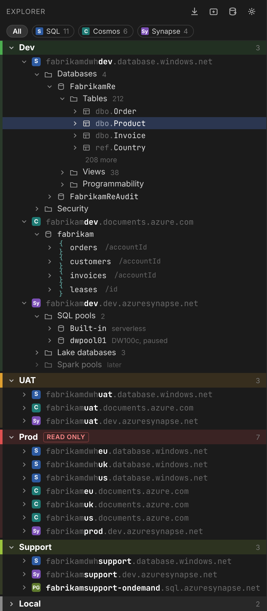 | 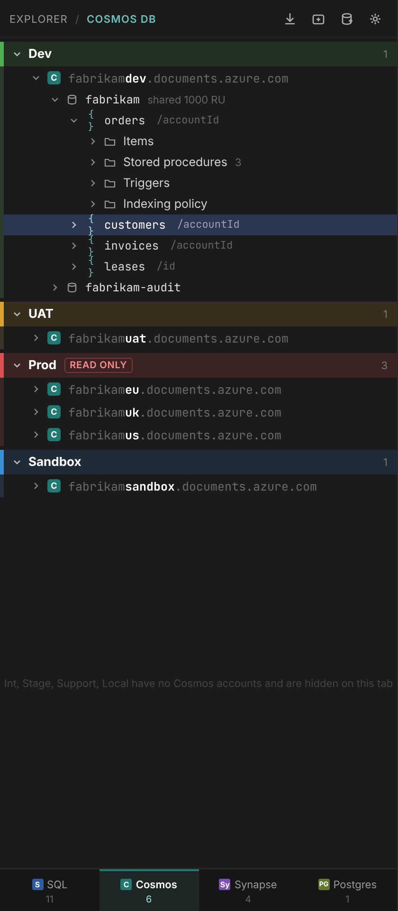 | 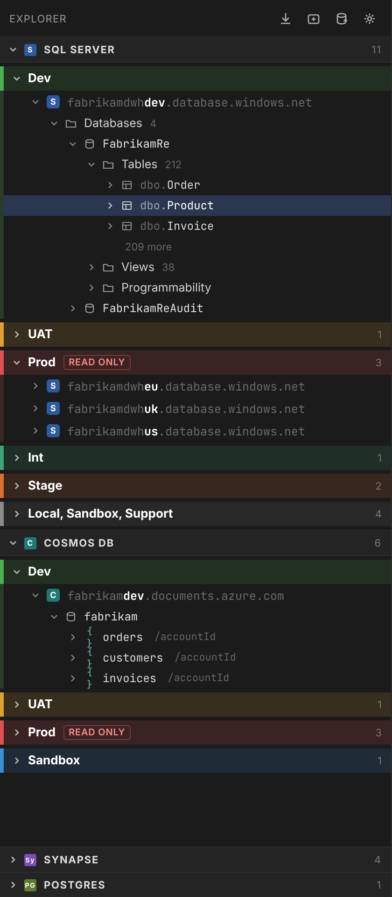 |

- **L1: One tree.** Environment first, every engine inside its environment, a
  small engine icon on each row, and a row of filter chips at the top to show
  only one engine when you want that.
- **L2: Tabs.** One tab per engine along the bottom, each showing an
  environment tree of just that engine. Environments with nothing of that
  engine disappear from the tab.
- **L3: Stacked sections.** The engines as top-level sections, environments
  repeated inside each one.

L1 is the one that matches how the tool is used: you go to an environment, then
pick what you need in it. L2 and L3 both make you choose an engine before you
can see the environment, and L3 repeats every environment three times. The
engine icon on every row got a setting to hide it for anyone who finds it noisy.

## 2. The What's new tab (30 Oct 2026)

Release notes open in a tab on the first launch after an update. The first cut
was a plain list of fragments, so this round tried three headers for it.

| A: Masthead band | B: Version gutter |
| :--: | :--: |
| 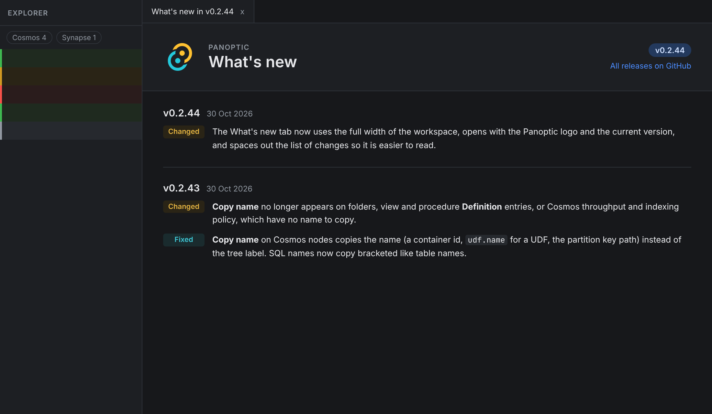 | 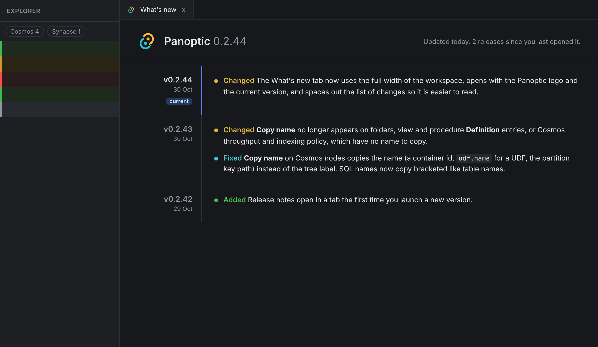 |

| C: Logo-colour hero | D: Combined (chosen) |
| :--: | :--: |
| 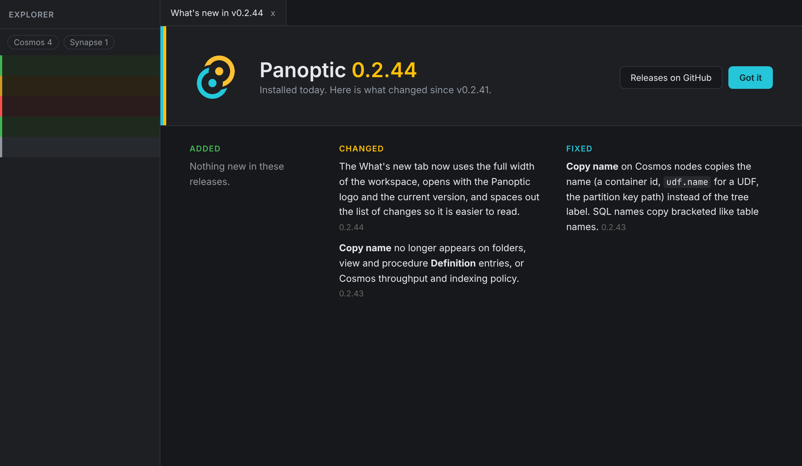 | 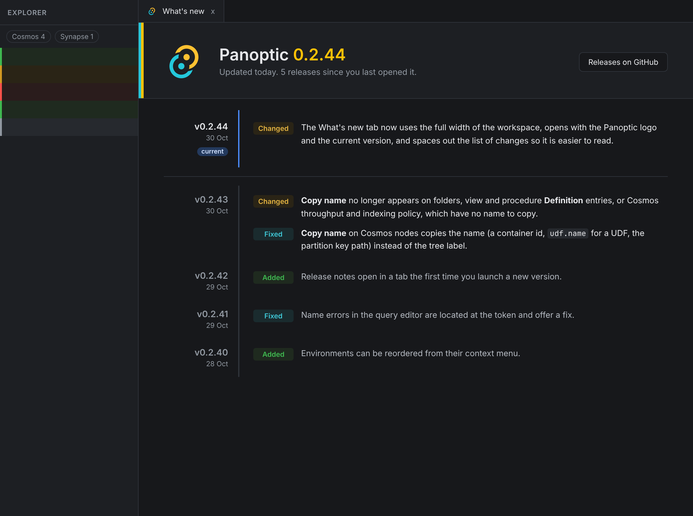 |

- **A: Masthead.** Logo, "What's new", a version pill and a link to GitHub
  releases, then the list grouped by version with a coloured change-type badge.
- **B: Version gutter.** Smaller header; the versions run down a left-hand
  gutter like a timeline, with the current one highlighted.
- **C: Hero.** The logo's amber and cyan as two bars down the edge, a big
  version number, and the changes laid out in three columns by type.
- **D: Combined.** C's header on top of B's gutter, with A's badges on each
  change.

D took the best part of each: the hero header makes it obvious which version
you are on, the gutter keeps older versions scannable, and the badges mean you
can skim for "Fixed" without reading every line.

## 3. The empty workspace and Seek (30 Oct 2026)

What should the app show when nothing is open? The honest answer was that the
tool is almost always opened to go to one specific place ("uk prod"), so the
start page should be the fastest route to that place rather than a dashboard.

### Landing directions

| A: Aperture | C: Quiet wordmark (chosen) |
| :--: | :--: |
| 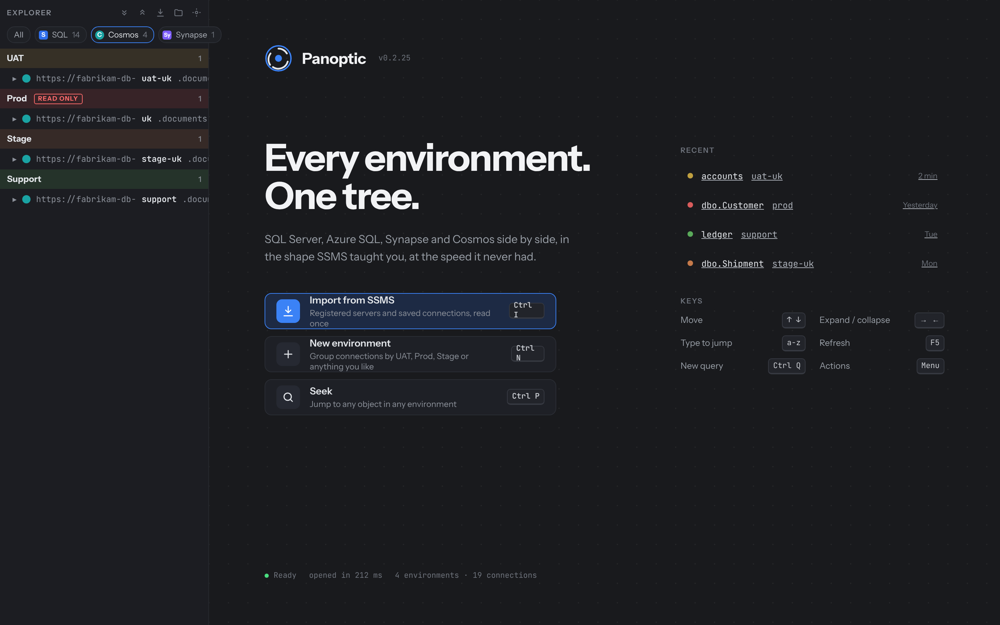 | 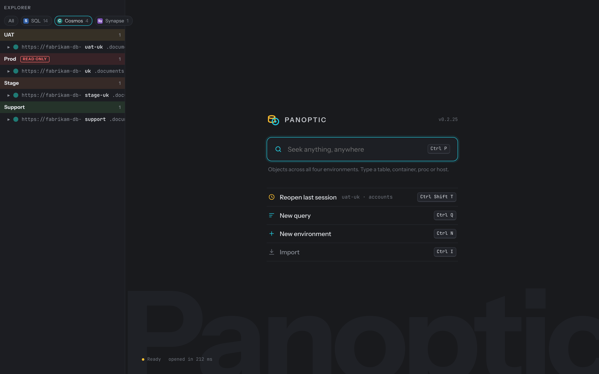 |

- **A: Aperture.** A marketing-style page: tagline, three big action cards,
  recent objects and a keyboard cheat sheet. Nice to look at, too much to read
  every time the app opens.
- **B** was an environment status board, with every environment as a tile and
  its health alongside. It never made it onto the canvas: at thirty
  environments it is a wall of tiles, and the engine status it would have
  shown is not something a user should need to know about.
- **C: Quiet wordmark.** One Seek box in the middle, a short list of actions
  under it, a faded wordmark in the corner. Import sits last because you do it
  once.

C is what shipped. Along the way a tagline overlaid on the faded wordmark and a
ring decoration in the background were both tried and taken out again as
distractions. The amber and cyan come from the logo.

### Seek, the one box

Seek is the find box on the landing page and the Ctrl+P palette inside the
app, so the same ranking had to work in three situations.

| Nothing typed | Typing "uk prod" | Thirty environments |
| :--: | :--: | :--: |
| 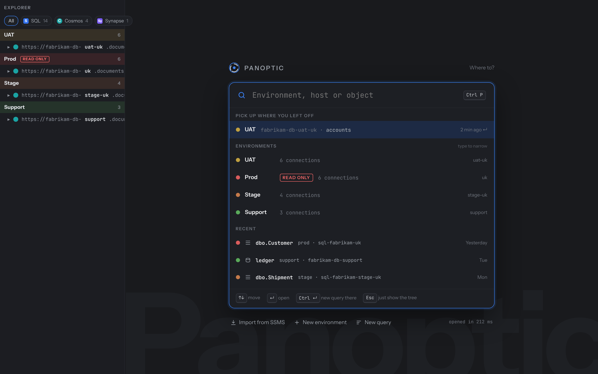 | 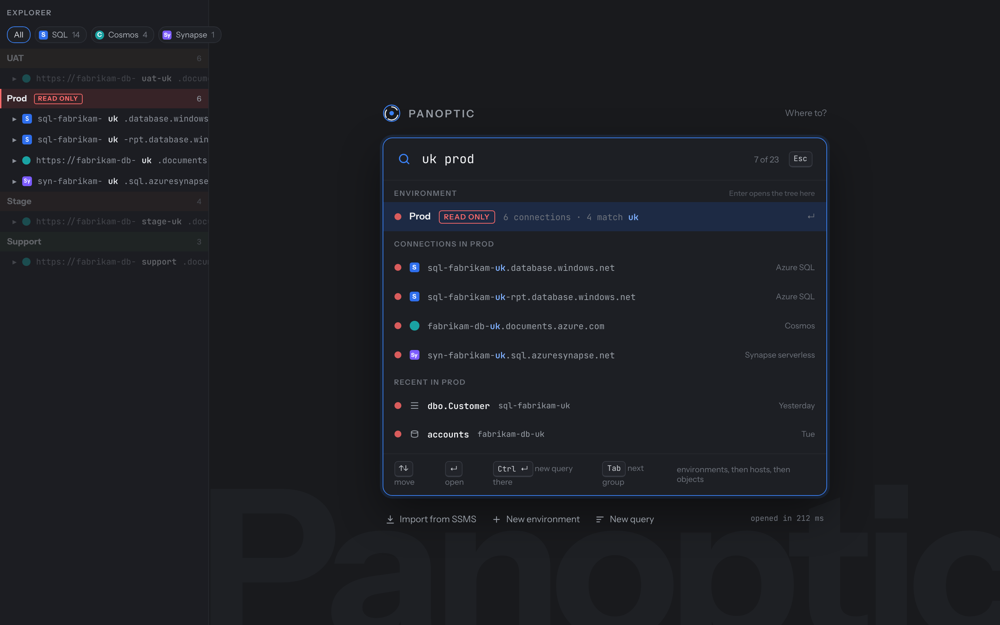 | 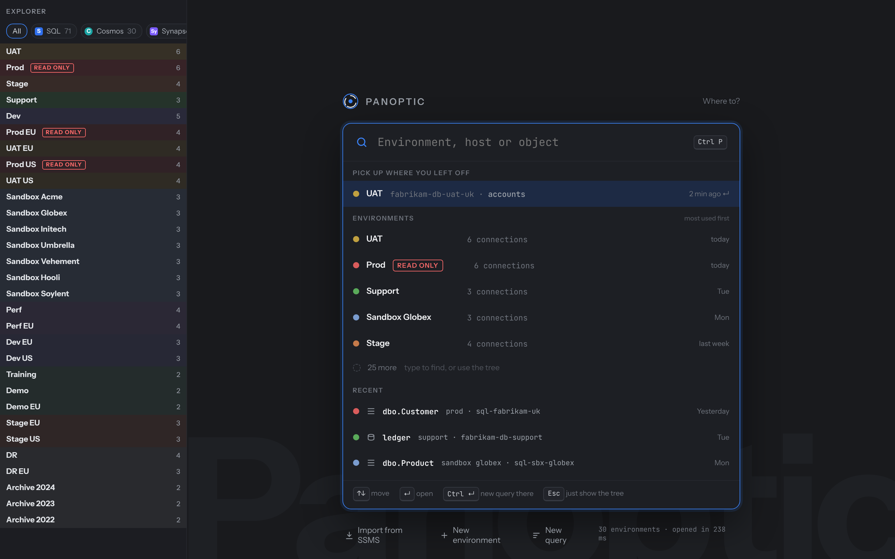 |

The rule that came out of these: environments first, then hosts in the top
environment, then recent objects. Typing "uk prod" puts Prod at the top with
only its `uk` hosts under it. With nothing typed, the box offers where you left
off and the most used environments, capped at five with a "25 more" hint, so a
large estate doesn't turn the start page back into a wall.

### Logo

The original two-ring mark had the right colours but said nothing about
databases. Five directions were drawn, then the two strongest were pushed
further.

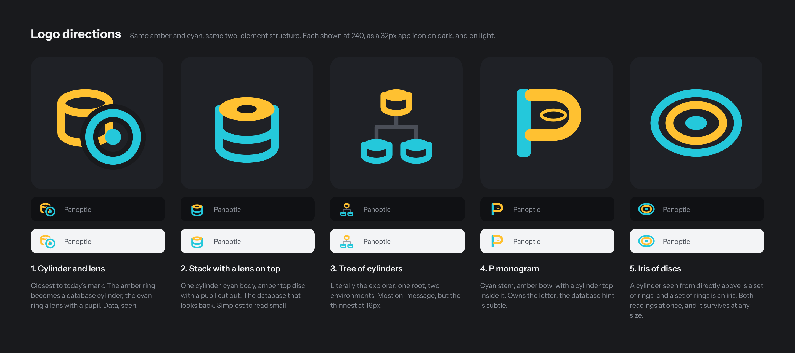

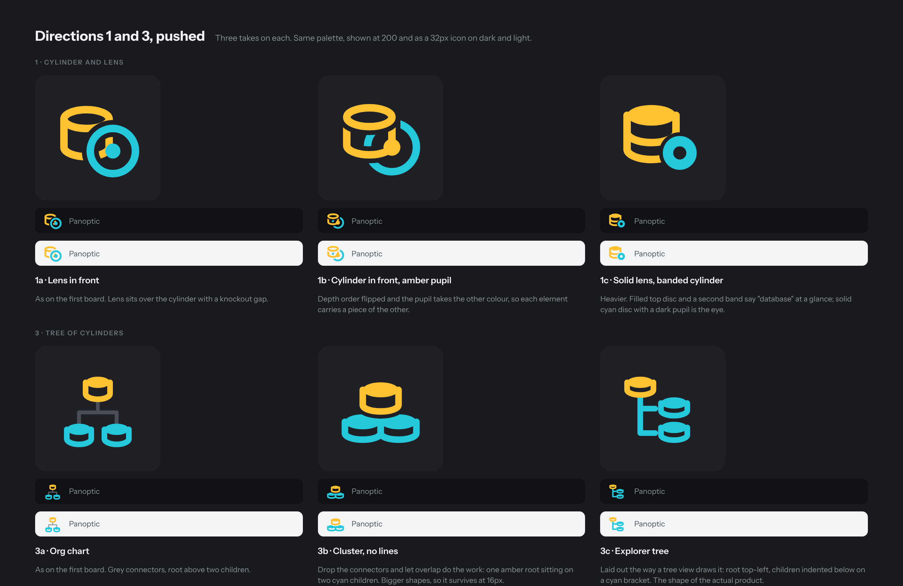

The shortlist was "cylinder and lens" against "tree of cylinders". The tree is
the most literal picture of the product, but it is the thinnest at 16px, which
is where an app icon lives most of the time. **1a, cylinder and lens** (amber
cylinder, cyan lens ring in front) is the current icon.

## 4. Explorer toolbar at narrow widths (31 Oct 2026)

Once the explorer had the engine chips, a problem showed up at narrow widths:
the header got squashed, and the chip row scrolled sideways behind an ugly
scrollbar. Collapse all and expand all also wanted a permanent home that didn't
depend on the header having room for them.

Each direction is shown at 250px and 420px.

| A: Trim the header | B: Engine filter as a dropdown | C: Filter box on top, actions in the footer (chosen) |
| :--: | :--: | :--: |
| 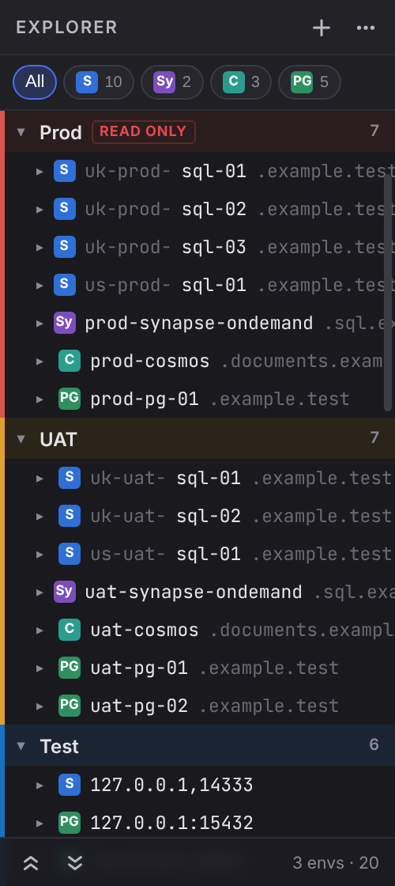 | 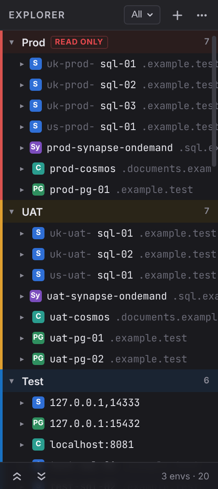 | 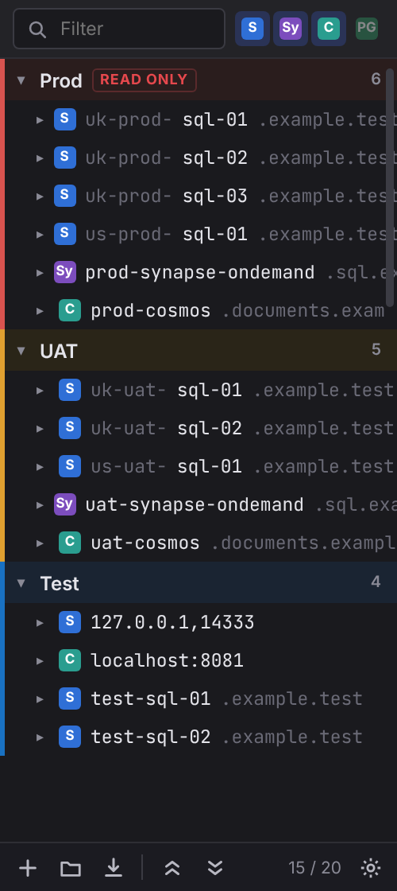 |
| 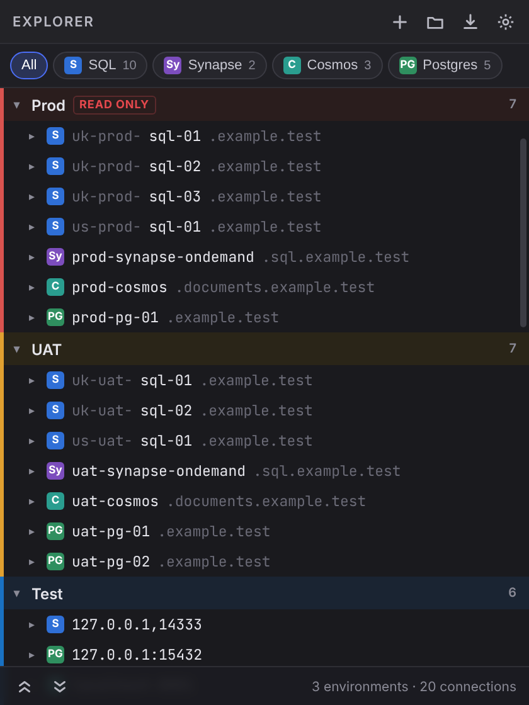 | 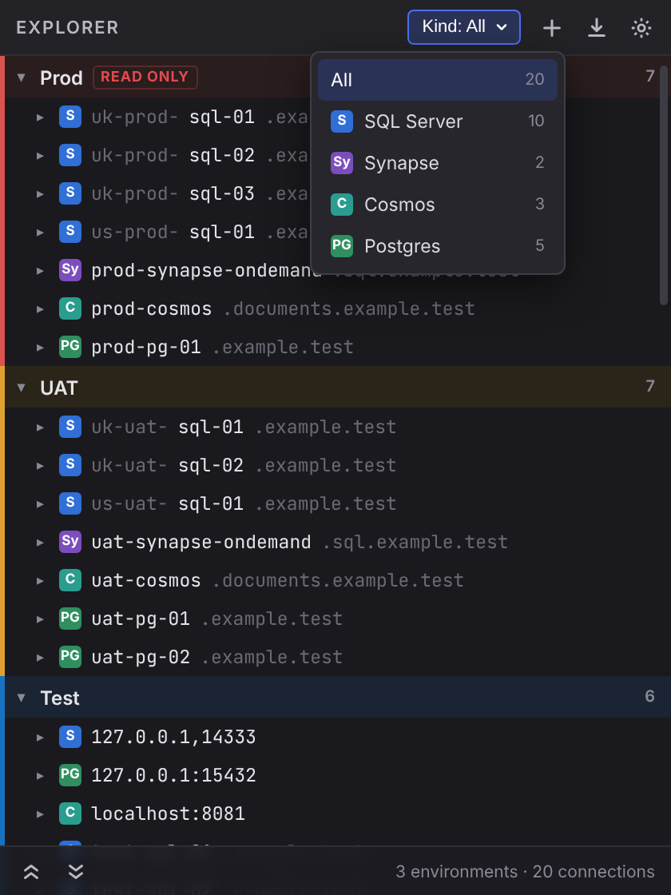 | 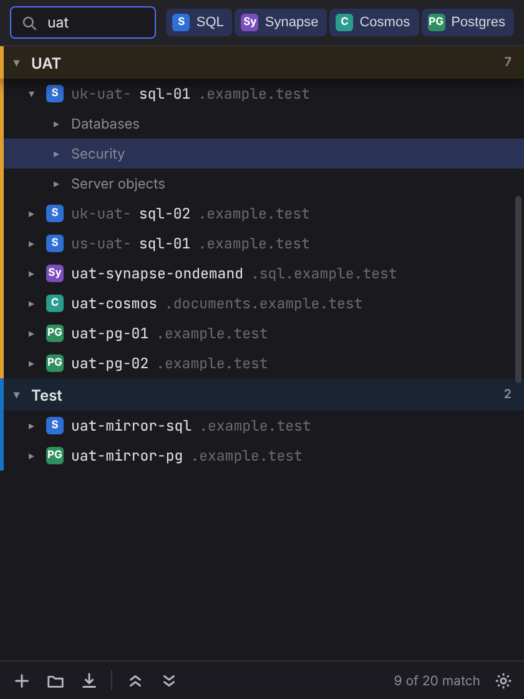 |

- **A.** Keep the header but cut it to New connection plus an overflow menu.
  Chips go icon-only with counts and get their labels back at wider widths.
  Collapse and expand move into a footer that is always present.
- **B.** No chip row. The engine filter is a dropdown in the header, so the
  header is one row at any width. Cheapest in vertical space, but every filter
  change is a click and a menu.
- **C.** Drop the EXPLORER title altogether. A text filter takes the top row,
  with engine toggles inside it that collapse into an "Engine n/total" button
  when they don't fit. Every action (new, import, folder, settings, collapse,
  expand) lives in the footer next to a match count, so nothing in the header
  competes for width.

C won because the text filter is useful in its own right and because the
footer never has to shrink. The popover handles the extreme case:

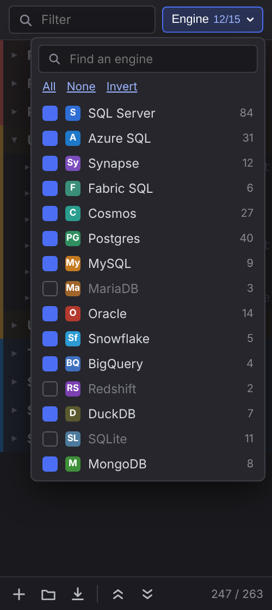

Fifteen engines on a 250px panel. The toggles have folded into one button, the
popover lists them with All, None and Invert, and the footer still shows
"247 / 263". The user-facing word is "engine"; the node contract keeps `kind`.
